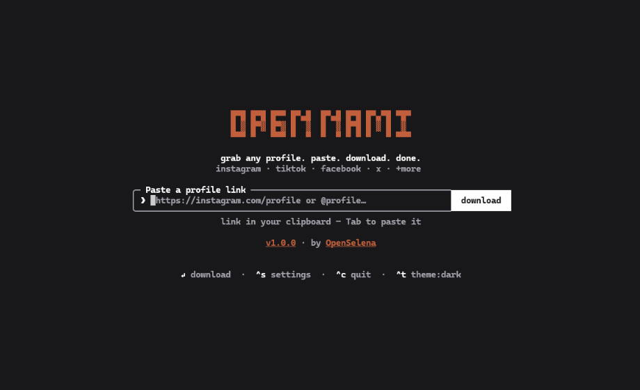
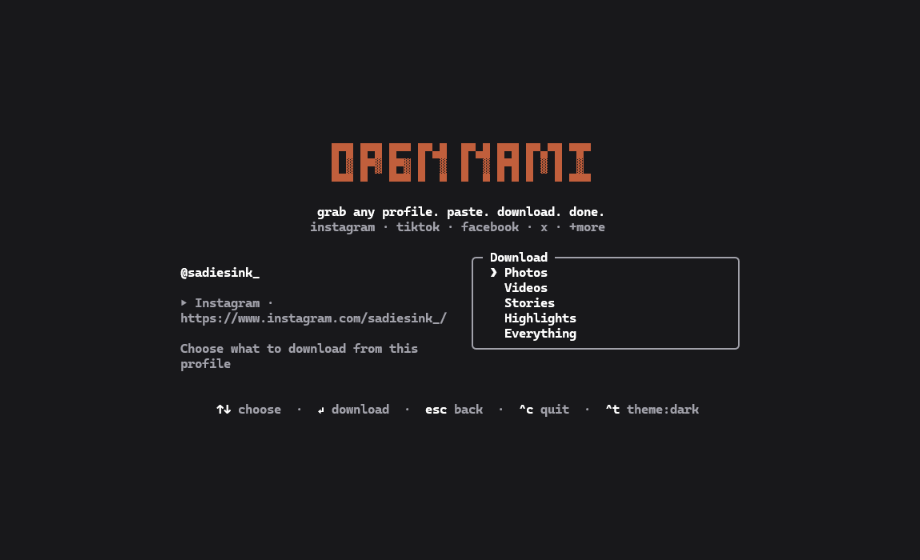
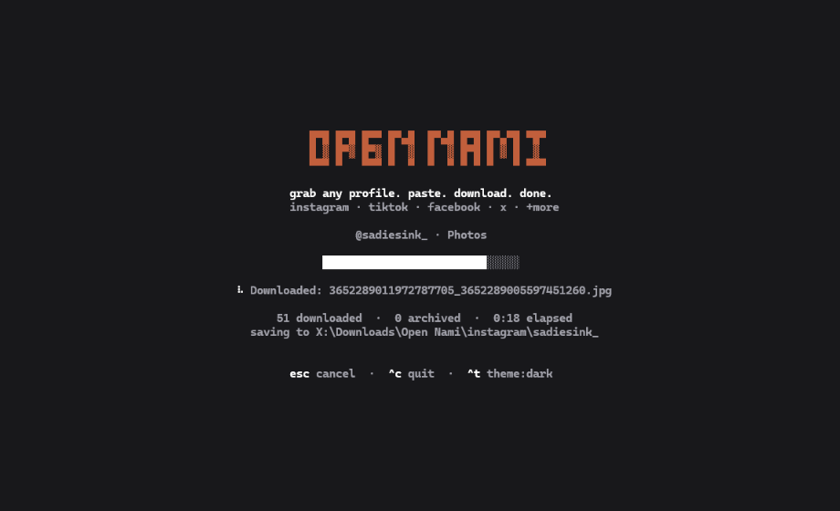

<p align="center">
  <picture>
    <source media="(prefers-color-scheme: dark)" srcset="https://raw.githubusercontent.com/OpenSelena/open-nami/main/assets/logo-dark.svg">
    
  </picture>
</p>

<p align="center">
  <b>Grab entire Instagram, TikTok, Facebook, and X profiles from your terminal.<br/>Photos, videos, stories, highlights, and incremental pulls in one free CLI and TUI.</b>
</p>

<p align="center">
  <a href="https://www.npmjs.com/package/open-nami"></a>
  <a href="https://pypi.org/project/open-nami/"></a>
  <a href="https://github.com/OpenSelena/open-nami/releases/latest"></a>
  <a href="https://github.com/OpenSelena/open-nami/stargazers"></a>
</p>

<p align="center">
  <a href="https://github.com/OpenSelena/open-nami/blob/main/LICENSE"></a>
  <a href="https://nodejs.org"></a>
  <a href="https://github.com/OpenSelena/open-nami/actions/workflows/ci.yml"></a>
  <a href="https://t.me/OpenSelena"></a>
</p>

<p align="center">
  <a href="#install"></a>
  &nbsp;
  <a href="#what-open-nami-downloads"></a>
</p>

---

## Contents

- [Why Open Nami](#why-open-nami)
- [Install](#install)
- [Your first download in one minute](#your-first-download-in-one-minute)
- [What Open Nami downloads](#what-open-nami-downloads)
- [Workflows and command line](#workflows-and-command-line)
- [Documentation](#documentation)
- [Privacy and what Open Nami refuses to do](#privacy-and-what-open-nami-refuses-to-do)
- [Frequently asked questions](#frequently-asked-questions)
- [Build from source](#build-from-source)
- [Credits](#credits)
- [Contributing and license](#contributing-and-license)

---

## Why Open Nami

You want a creator's whole feed backed up on your disk without clicking through hundreds of web pages or keeping a cheat sheet of `gallery-dl` and `yt-dlp` flags. One site drops your session if requests fire too fast, another serves HTTP 403 or Slardar WAF challenges on slide posts, and stories fail silently when browser cookies are out of date.

Open Nami puts that workflow behind one terminal UI and one short CLI (`open-nami`, `opennami`, `nami`, `on`). Paste a profile URL or `@handle`, pick photos, videos, stories, highlights, or everything, and let the two-tier extractor sort files into folders while remembering what you already downloaded.

<p align="center">
  
</p>

<table>
  <tr>
    <td></td>
    <td></td>
  </tr>
</table>

### How it compares

| | Open Nami | `gallery-dl` / `yt-dlp` alone | Single-site web downloaders |
|---|---|---|---|
| **Supported feeds** | Instagram, TikTok, Facebook, and X native extractors + engine failover | Works, requires per-site config and flags | One site, often one post at a time |
| **Setup** | `npm i -g open-nami` or `pip install open-nami`; binaries auto-download | Manual install, `PATH` setup, cookie flags | None |
| **Logged-in cookies** | Browser Cookie Bridge auto-detects OS default browser + `0600` temp isolation | Manual `--cookies` export or browser arg per call | Paste session or none |
| **Incremental updates** | SQLite tracking (`nami pull`) stops after 5 consecutive archived posts | Separate archive flags per tool | No |
| **Rate limits & WAF** | Platform sleep jitter, Slardar WAF solver, Chrome TLS fallback, 429 cooldown | Manual flags per site | Rate-limited or server-queued |
| **Price and license** | Free, MIT | Free, GPL-2.0 / Unlicense | Free with ads or paid limits |

Open Nami builds on `gallery-dl` and `yt-dlp` for fallback extraction and would not exist without them. If you only grab occasional links and already write your own shell scripts, running those tools directly from the command line is already enough.

---

## Install

Requires **Node.js 20+** (22.5+ enables native `node:sqlite`; Node 20 falls back cleanly to disk-persisted JSON storage). `gallery-dl` and `yt-dlp` download automatically into `~/.open-nami/bin/` on first run. Install `ffmpeg` if you want stream muxing and best-quality video merges.

<table>
  <tr>
    <th align="left">Method</th>
    <th align="left">Command</th>
    <th align="left">Notes</th>
  </tr>
  <tr>
    <td><b>npm</b></td>
    <td><code>npm install -g open-nami</code></td>
    <td>Registers <code>open-nami</code>, <code>opennami</code>, <code>nami</code>, and <code>on</code> globally</td>
  </tr>
  <tr>
    <td><b>pip (PyPI)</b></td>
    <td><code>pip install open-nami</code></td>
    <td>Python wrapper bundled with standalone CLI (still uses Node.js 20+)</td>
  </tr>
  <tr>
    <td><b>Homebrew</b></td>
    <td><code>brew install OpenSelena/tap/open-nami</code></td>
    <td>macOS and Linux tap formula</td>
  </tr>
  <tr>
    <td><b>Installer script</b></td>
    <td><code>curl -fsSL https://raw.githubusercontent.com/OpenSelena/open-nami/main/install.sh | sh</code></td>
    <td>macOS and Linux shell installer</td>
  </tr>
  <tr>
    <td><b>Zero-install</b></td>
    <td><code>npx open-nami [profile-or-url]</code></td>
    <td>Run directly without installing globally</td>
  </tr>
</table>

---

## Your first download in one minute

1. Launch the interactive TUI with `nami` (or `on`, `opennami`, `open-nami`). On first launch, Open Nami downloads `gallery-dl` and `yt-dlp` into `~/.open-nami/bin/`.
2. Paste any profile URL (`https://www.instagram.com/natgeo/`), `@handle`, or shortcut prefix (`tt:zachking`, `ig:selenagomez`, `fb:NASA`, `x:elonmusk`), or press **`Tab`** to paste from your clipboard.
3. Choose **Photos**, **Videos**, **Stories**, **Highlights**, or **Everything** and press **`Enter`**. Files land under `~/Downloads/Open Nami/<platform>/<username>/<category>/`.

Run `nami pull` later to download only newly posted items without re-scanning old archives.

---

## What Open Nami downloads

Open Nami runs Tier 1 native extractors in-process for speed and cleaner metadata, then falls back automatically to `gallery-dl` and `yt-dlp` when a platform changes markup or requires external extractors.

| Platforms&nbsp;&amp;&nbsp;Capabilities | Details |
|---|---|
| &nbsp;**Instagram** | Feed photos, carousels, videos, reels, active 24h stories *(requires cookies)*, and pinned profile highlights *(requires cookies)*. Throttles GraphQL pagination (`2.0s–2.8s` jitter) and downloads directly from Meta CDN edges. |
| &nbsp;**TikTok** | Videos, carousels / photo slides, audio, avatars, and full profile archives. Native extractor solves Slardar WAF (`_wafchallengeid`) SHA-256 challenges; fallback passes Chrome TLS impersonation (`--impersonate chrome`) and disables video extractors on photo slides to prevent HTTP 403. |
| &nbsp;**Facebook** | Profile photos, videos, `/reel/` permalinks, `fb.watch` links, and public albums using canonical host rewriting (`mbasic`/`m`) and fallback pagination. |
| &nbsp;**X&nbsp;/&nbsp;Twitter** | Timeline photos, videos, GIFs, self-reply threads (filtering unrelated replies), and likes history with randomized query delays. |
| &nbsp;**Pull&nbsp;sync** | Incremental pulls use a local SQLite registry (`~/.open-nami/nami.db`) with disk discovery and reverse-chronological early exit after 5 consecutive already-archived posts. |
| &nbsp;**Cookies** | Browser Cookie Bridge auto-detects your OS default browser (`chrome`, `edge`, `brave`, `firefox`, `zen`, `librewolf`, `chromium`, `opera`, `vivaldi`, `helium`, plus Linux Flatpak paths), reads Gecko SQLite cookies without locks, and exports ephemeral `0600` session files. |
| &nbsp;**Archives** | Sorted output folders (`<platform>/<username>/<category>/`), timestamp (`mtime`) sync, deduplication ledgers (`archive_gallery-dl.sqlite3`, `archive_yt-dlp.txt`), and JSON caption sidecars (`--write-metadata`). |

---

## Workflows and command line

Every option works identically across `open-nami`, `opennami`, `nami`, and `on`. When called with an input target and media flag (`--photos`, `--videos`, `--stories`, `--highlights`, `--all`), Open Nami runs headlessly without launching the TUI.

### &nbsp;Direct downloads, filters, and sidecars

```sh
# Jump into interactive picker or download a category headlessly
nami https://www.instagram.com/natgeo/
nami @creator --photos
nami tt:creator --videos
nami ig:username --stories
nami ig:username --highlights
nami @username --all

# Date bounds, item limit, checkpoint resume, metadata sidecars & custom output folder
nami @creator --photos --since 7d -l 25 --write-metadata
nami @creator --since 2026-01-01 --until 2026-06-01 --resume -o ./archive
```

### &nbsp;Incremental pulls and tracked profiles

```sh
nami pull                 # Pull new posts across all tracked profiles (alias: nami sync)
nami pull @creator        # Pull updates for one creator (--early-exit 10 supported)
nami list                 # Print table of tracked profiles, media counts & last sync
nami track tt:zachking    # Register a creator profile without downloading yet
nami untrack zachking     # Remove from registry (keeps files on disk; use --all to clear)
```

Pass `--no-track` on any single download command if you want a one-off archive without adding the profile to your tracking list.

### &nbsp;Clipboard watcher and batch queue

```sh
nami -w                   # Watch clipboard for profile URLs and download automatically
nami -b profiles.txt      # Process a list of URLs or handles (# and // comments ignored)
nami -b handles.txt -p tiktok --photos
```

### &nbsp;Diagnostics, engine updates, and shell completions

```sh
nami --doctor             # Check Node runtime, SQLite, gallery-dl, yt-dlp, ffmpeg & cookies
nami -U                   # Update bundled gallery-dl and yt-dlp binaries in place
nami --completion zsh     # Generate completions (bash, zsh, fish, powershell)
```

### &nbsp;Hotkeys in TUI

| Scope | Key | Action |
| :--- | :--- | :--- |
| **Home (`InputView`)** | **`[Tab]`** | Paste URL from clipboard |
| | **`[Enter]`** | Submit URL / Start download |
| | **`[^w]`** *(Ctrl+W)* | Open Clipboard Watcher |
| | **`[^b]`** *(Ctrl+B)* | Open Batch queue manager |
| | **`[^s]`** *(Ctrl+S)* | Open Settings (cookies, browser bridge, output path, metadata, limit) |
| | **`[^p]`** or **`[p]`** | Open `PullView` (`[p]` triggers when URL input is empty) |
| **`PullView`** | **`[Space]`** / **`[a]`** | Toggle selected profile / Toggle all |
| | **`[d]`** / **`[c]`** | Untrack selected profile / Clear all tracked profiles |
| | **`[Enter]`** | Pull updates for selected profiles |
| **Watcher / Batch** | **`[c]`** / **`[m]`** | Cycle target (`all`/`photos`/`videos`) / Toggle metadata `.json` |
| | **`[d]`** / **`[l]`** / **`[r]`** | *(Batch)* Cycle date range, post limit, checkpoint resume (`[Tab]` switches field) |
| **Menus & Results** | **`[↑ / ↓]`** | Navigate menus (`Platform`, `Picking`, `PullView`, `Settings`) |
| | **`[o]`** | Open destination folder (completion / watcher) |
| **Global** | **`[^t]`** *(Ctrl+T)* | Cycle theme (`auto` / `light` / `dark`) |
| | **`[Esc]`** / **`[^c]`** | Back or cancel / Quit |

---

## Documentation

Full references live in [`docs/`](https://github.com/OpenSelena/open-nami/tree/main/docs):

- &nbsp;**[CLI Reference](https://github.com/OpenSelena/open-nami/blob/main/docs/cli-reference.md)** — Subcommands, flags, exit codes, and scripting examples.
- &nbsp;**[Configuration Guide](https://github.com/OpenSelena/open-nami/blob/main/docs/configuration.md)** — `~/.open-nami/config.json` schema, settings panel, and environment variables.
- &nbsp;**[Cookie Authentication](https://github.com/OpenSelena/open-nami/blob/main/docs/cookies.md)** — Browser Cookie Bridge, Netscape `.txt` filenames, and ephemeral cookie isolation.
- &nbsp;**[Anti-Bot Hardening](https://github.com/OpenSelena/open-nami/blob/main/docs/anti-bot.md)** — Platform jitter timings, TLS impersonation, 429 cooldowns, and deduplication archives.
- &nbsp;**[Shell Autocompletion](https://github.com/OpenSelena/open-nami/blob/main/docs/autocompletion.md)** — Setup snippets for Bash, Zsh, Fish, and PowerShell.
- &nbsp;**[Fair Use Notice](https://github.com/OpenSelena/open-nami/blob/main/docs/fair-use.md)** — Section 107 archiving principles and usage disclosures.

---

## Privacy and what Open Nami refuses to do

Everything downloads straight to your machine. There is no account, no remote job queue, no analytics SDK, and no upload of your cookies, URLs, or history ledger. Cookies live locally in your browser profile or Netscape cookie folder and are copied strictly to per-user `0600` temp directories removed when each job ends.

Outside requests to the platforms you tell it to download from, the only network calls Open Nami makes are downloading open-source `gallery-dl` / `yt-dlp` binaries from their GitHub releases (first run or `-U`), an optional 24-hour cached version lookup against the npm registry, and reading `announcements.json` on GitHub.

Open Nami only downloads public media or content your own logged-in cookies can already view. It does not bypass DRM, break paywalls, or distribute credentials. You are responsible for respecting copyright and each platform's terms; see the [Fair Use Notice](https://github.com/OpenSelena/open-nami/blob/main/docs/fair-use.md).

---

## Frequently asked questions

**Is Open Nami free?**
Yes. MIT-licensed, no paid tier, no ads, and no telemetry accounts.

**Is Open Nami just a wrapper around `gallery-dl` and `yt-dlp`?**
Partly. Both engines handle fallback extraction and media muxing, and Open Nami provisions and updates them automatically. On top of that sit Tier 1 native extractors (including TikTok Slardar WAF solving and Instagram/Facebook fallbacks), a Browser Cookie Bridge, SQLite incremental pull tracking (`nami pull`), clipboard watching, and an Ink terminal UI.

**Can it download Instagram stories, highlights, or private profiles?**
Yes, when authenticated via your own browser session (Browser Cookie Bridge, set to `auto` by default) or Netscape cookie files (`instagram_cookies.txt`). See [Cookie Authentication](https://github.com/OpenSelena/open-nami/blob/main/docs/cookies.md).

**What happens when I run `nami pull` later?**
Open Nami walks each tracked profile in reverse chronological order and halts once it sees 5 consecutive previously archived posts (skipping pinned items so old pins do not stop sync early). Existing media counts on disk are discovered automatically.

**Can I run it headlessly in cron or shell scripts?**
Yes. Pass both a profile target and a media flag (`nami @creator --photos -o /data/archives`) or run `nami pull`, `nami list`, `nami -b list.txt`, or `nami --doctor`.

**Does it need Python?**
Not required if installed via npm or Homebrew (`gallery-dl` and `yt-dlp` standalone binaries auto-download into `~/.open-nami/bin/`). Python 3.9+ is only needed if you install the PyPI wrapper package (`pip install open-nami`), which still invokes Node.js 20+.

---

## Build from source

Requires [Node.js](https://nodejs.org/) 20+ and npm:

```sh
git clone https://github.com/OpenSelena/open-nami.git
cd open-nami
npm ci
npm test && npm run typecheck && npm run build
npm start
```

---

## Credits

Open Nami is built on:

- [gallery-dl](https://github.com/mikf/gallery-dl), [yt-dlp](https://github.com/yt-dlp/yt-dlp), and [FFmpeg](https://ffmpeg.org/) for fallback extraction and stream muxing
- [React](https://react.dev/), [Ink](https://github.com/vadimdemedes/ink), and [ink-select-input](https://github.com/vadimdemedes/ink-select-input) for the terminal interface
- [tsup](https://tsup.egoist.dev/) and [tsx](https://tsx.is/) for bundling and TypeScript test execution

---

## Contributing and license

Bug reports and pull requests go to [Issues](https://github.com/OpenSelena/open-nami/issues) and [Pull requests](https://github.com/OpenSelena/open-nami/pulls). Questions live on [Telegram](https://t.me/OpenSelena) or via email at [igect@vk.com](mailto:igect@vk.com).

Open Nami is released under the [MIT License](https://github.com/OpenSelena/open-nami/blob/main/LICENSE) by [OpenSelena](https://github.com/OpenSelena).

<p align="center">
  <a href="https://github.com/OpenSelena/open-nami/releases/latest"><b>Latest release</b></a> · <a href="https://www.npmjs.com/package/open-nami">npm</a> · <a href="https://pypi.org/project/open-nami/">PyPI</a> · <a href="https://github.com/OpenSelena/open-nami/blob/main/LICENSE">MIT</a>
</p>
